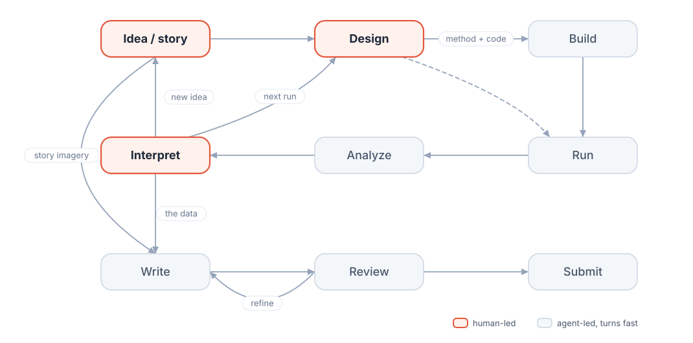
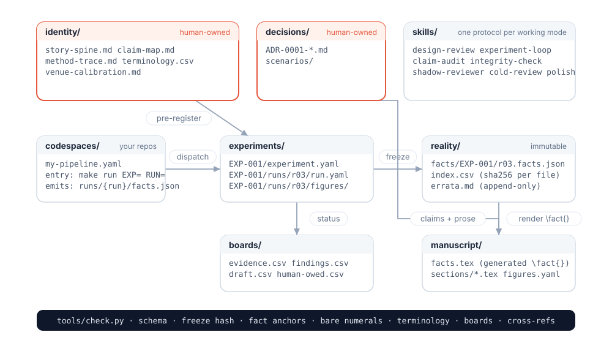
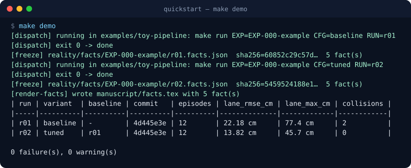
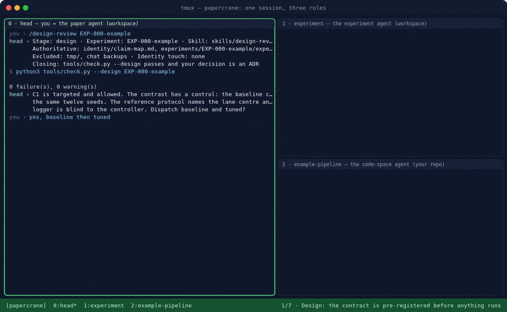
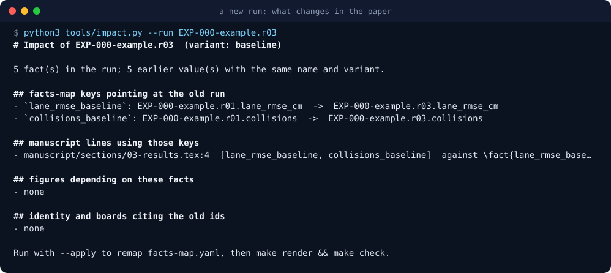
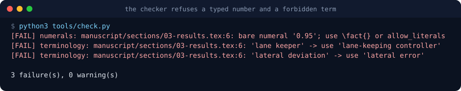

<p align="center">
  
</p>

<h1 align="center">papercrane</h1>

<p align="center"><b>Fold the paper with the agent from day one.</b><br>
A research workspace where the human owns the idea, the design and the interpretation,<br>
the agent turns the experiment loop, and the manuscript is rendered from frozen facts.</p>

<p align="center">
  <a href="README.zh-TW.md">繁體中文</a> ·
   
   
  
</p>

---

## The human owns three nodes; the agent turns the loop

Co-developing research with an agent is hard because you have to align on abstract
concepts and on concrete detail at the same time, stay rigorous throughout, and keep both
the work and the content flexible. The way out is to decide who owns what.

The idea and its story arc, the hypothesis behind a design, and the interpretation of what
came back are where the human is fully present and fully aligned with the agent. Once those
three are aligned, the two of you can align on the experimental data; without that anchor
the agent overfits to the last result or drifts until the signal is buried in noise.
Everything between those nodes is agent-led and has to turn fast: building, running,
freezing, plotting, drafting, checking. The researcher spends attention on thinking while
the iteration underneath runs quickly and stays auditable.

| Stage | Lead | Produces |
|-------|------|----------|
| **Idea** | human | `identity/story-spine.md`; one decision record per directional choice |
| **Design** | human | `experiments/<id>/experiment.yaml`, pre-registered against the claim map |
| Build | agent | method and analysis code in a code space that satisfies the adapter contract |
| Run | agent | a run record with command, commit and input hashes |
| Analyze | agent | hash-pinned facts in `reality/`, plots, a report phrased as questions |
| **Interpret** | human | what it means and what comes next, as `decisions/ADR-*.md` |
| Write | agent | claim rows anchored to fact ids; a manuscript built from facts and human prose |
| Review | agent, plus a cold external model | findings with severity; the human adjudicates |
| Submit | human | the package, with the human-owed queue empty |

## Every number in the manuscript is rendered from a frozen fact

<p align="center"></p>

- A **code space** is any repo of yours, attached with a twelve-line adapter. The loop runs
  it with one command and harvests a `facts.json` that carries its own provenance.
- **Freeze** copies the facts into `reality/` with a sha256 per file. Frozen files stay as
  written; a correction is a new run plus a line in the errata log.
- **Render** compiles the facts you chose into `manuscript/facts.tex`. Prose uses
  `\fact{lane_rmse_tuned}`; a typed numeral fails the build.
- **Check** verifies every arrow: schemas, frozen hashes, fact anchors behind each claim,
  bare numerals, forbidden terms, board cells, dangling references.

## Five commands to a rendered result

```bash
git clone <this repo> my-paper && cd my-paper
python3 tools/check.py        # the empty workspace validates
make demo                     # dispatch two toy runs, freeze, render, compare, check
make status                   # the experiment registry, also written to experiments/INDEX.md
make demo-clean               # back to the empty workspace
```

<p align="center"></p>

The demo runs `examples/toy-pipeline`, a fake code space: a lane-keeping evaluation on a
simulated track, baseline controller against a tuned one on the same seeds. Copy
`codespaces/example-pipeline.yaml`, point it at your own repo, and the same five commands
run your analysis, in any domain.

## One session, three panes

<p align="center"></p>

You sit in the left pane with the paper agent and do the thinking: pre-register the design,
read the report, decide, approve the decision record. The experiment agent in the top-right
pane turns the loop: dispatch, wait, freeze, compare, report back as questions. The
code-space agent in your own repository runs `make run` and acknowledges with a facts file.
`make session` replays this on the toy pipeline with every command really run;
[docs/session-walkthrough.md](docs/session-walkthrough.md) explains the eight beats and
`tools/dev/tmux-session.sh` opens the three panes for your own paper.

## A new run tells you what it changes in the paper

The question a new experiment always raises is which sentences, figures and claims now
rest on a stale number. `tools/impact.py` answers it from the facts map, the manuscript, the
figure registry and the claim map, and `--apply` remaps the facts map so the next render picks
the new values up. Identity rows are listed for the human to act on; a changed claim is a
human decision.

<p align="center"></p>

## The checker refuses what a reviewer would catch

<p align="center"></p>

Rules the checker cannot express are candidates for deletion. The ceremony of the first
generation, five manual writes per edit, became `tools/check.py`.

## Your code becomes a code space

```yaml
name: my-pipeline
path: /home/me/github/my-pipeline
kind: pipeline
entry:
  command: "make run EXP={experiment} RUN={run_id} CFG={config}"
emits:
  facts: "runs/{run_id}/facts.json"
provenance:
  code_commit: "git rev-parse HEAD"
  inputs: []            # the exporter hashes what it actually read
preapproved_commands: ["make run *"]
```

Attaching a repo asks three things of it: run a named experiment from one command, emit
facts with provenance, keep its claims in `identity/`. Those are reproducibility habits, and
the loop asks for them on every run. A real attachment is walked through in
[docs/worked-example-pipeline.md](docs/worked-example-pipeline.md).

## Protocols replace conversational memory

Every working mode is a **skill**: when to invoke it, what to read, what to leave unread,
the steps, the known failure patterns, and a closing condition a second agent could verify.
Sessions open with an eight-line contract that names the stage, the experiment, the inputs,
the excluded inputs, and the skill.

| Read first | Then | When you need them |
|------------|------|--------------------|
| `design-review` · `experiment-loop` · `claim-audit` | `story-design` · `method-design` · `polish` | `shadow-reviewer` · `integrity-check` · `cold-review` · `venue-calibration` · `new-evidence-integration` |

The parts that belong to your taste are data files you fill: `identity/terminology.csv`,
`identity/style-words.csv`, `reviews/review-lenses.md`, `identity/venue-calibration.md`.
Change the rest to match your habits and keep the invariants in [CLAUDE.md](CLAUDE.md).

## Refined across three papers

This is the third version of a way of working its author iterated across three papers. The
previous version ran the third paper end to end; its shortcomings, hand-copied numbers,
experiment design outside the loop, facts kept as prose, ceremony that could be gamed, are
the design inputs of this one. [docs/lessons-learned.md](docs/lessons-learned.md) records
them and [docs/design.md](docs/design.md) answers them.

Roadmap and open items: [docs/release-checklist.md](docs/release-checklist.md).

<details>
<summary><b>Layout</b></summary>

```
papercrane/
├── CLAUDE.md / AGENTS.md     agent invariants, roles, the never-list
├── docs/                     design, lessons learned, session contract, worked example, checklist
├── identity/                 story-spine, claim-map, method-trace, terminology, style words, venue
├── experiments/              one folder per experiment: design contract, runs, figures, notes
├── codespaces/               adapters to your repositories
├── reality/                  frozen facts (sha256 per file), index, errata
├── boards/                   evidence, findings, draft, human-owed (small-cell CSV)
├── decisions/                ADR-style decision log, agent-readable
├── reviews/                  review syntheses, reviewer lenses, reviewer reserve
├── skills/                   eleven protocols
├── manuscript/               LaTeX prose, generated facts.tex, figures map, labels
├── examples/toy-pipeline/    the quickstart's fake code space
├── schemas/                  JSON Schema for experiment, run, facts, codespace
└── tools/                    check, dispatch, freeze, render-facts, impact, status, compare, bus
```
</details>

## Attribution and license

Ideas credited in [ATTRIBUTION.md](ATTRIBUTION.md); the text here is original, and
`tools/dev/overlap_check.py` is the release gate for that. License: [MIT](LICENSE).
