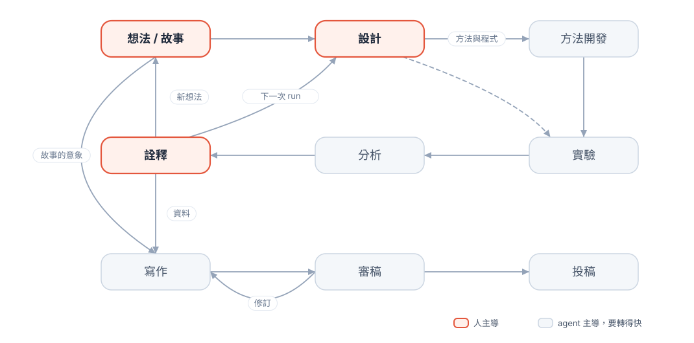
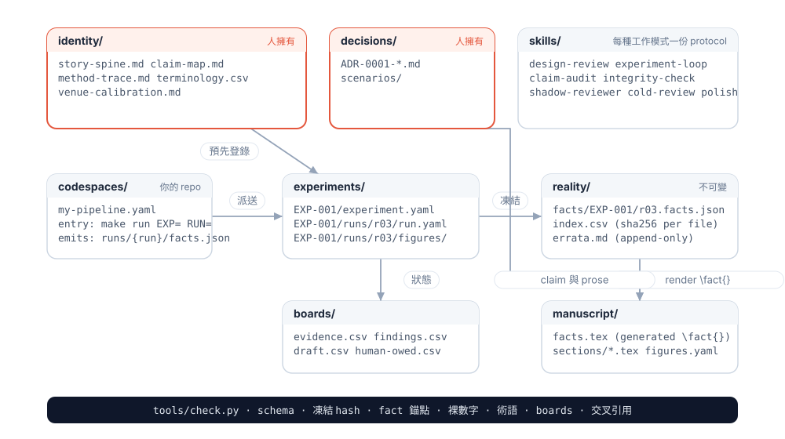
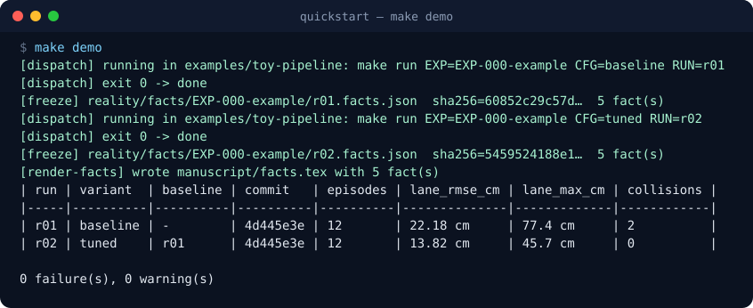
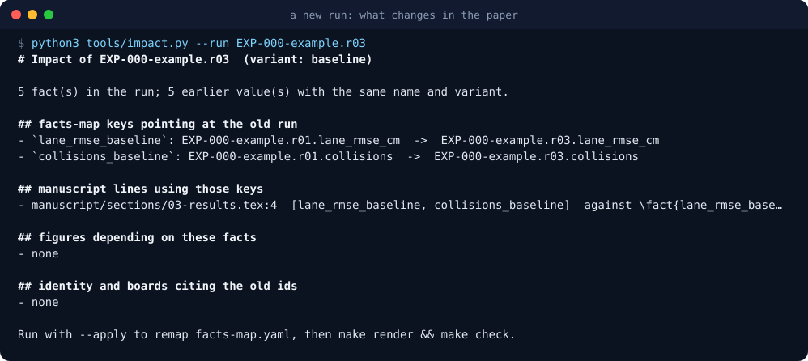
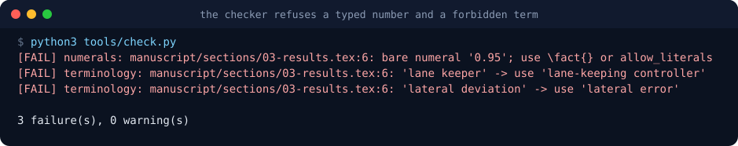

<p align="center">
  
</p>

<h1 align="center">papercrane</h1>

<p align="center"><b>從第一天起，就和 agent 一起把論文摺出來。</b><br>
一個研究工作區：人擁有想法、設計與詮釋，agent 轉動實驗 loop，稿件由凍結的事實 render 出來。</p>

<p align="center">
  <a href="README.md">English</a> ·
   
   
  
</p>

---

## 人擁有三個節點，agent 轉動 loop

和 agent 共同開發研究很難，因為你得同時對齊抽象概念與具體細節，全程保持嚴謹，工作與內容又都
要保持彈性。出路是先講清楚誰擁有什麼。

想法與它的故事線、設計背後的假設、對回來的結果的詮釋，是人完整在場、並且與 agent 對齊好的
地方。這三處對齊了，兩方才有辦法在實驗數據上對齊；沒有這個錨，agent 會對上一個結果 local
overfit，或一路漂移到訊號淹沒在雜訊裡。三個節點之間的其他環節由 agent 主導，而且必須轉得快：
開發、執行、凍結、畫圖、起草、檢查。研究者把注意力放在思考上，底下的迭代快速進行並且可稽核。

| 階段 | 主導 | 產出 |
|------|------|------|
| **想法** | 人 | `identity/story-spine.md`；每個方向性選擇一筆決策紀錄 |
| **設計** | 人 | `experiments/<id>/experiment.yaml`，對 claim map 預先登錄 |
| 方法開發 | agent | code space 裡滿足 adapter 契約的方法與分析程式 |
| 實驗 | agent | 帶指令、commit 與輸入 hash 的 run 紀錄 |
| 分析 | agent | `reality/` 裡 hash 固定的事實、圖、以問句寫成的報告 |
| **詮釋** | 人 | 這代表什麼、接下來做什麼，寫成 `decisions/ADR-*.md` |
| 寫作 | agent | 錨定到 fact id 的 claim 列；由事實與人寫 prose 建出的稿件 |
| 審稿 | agent 加一個冷讀的外部模型 | 帶嚴重度的 findings；人裁決 |
| 投稿 | 人 | 投稿包；人欠的待辦清空 |

## 稿件裡的每個數字都從凍結事實 render 出來

<p align="center"></p>

- **code space** 是你任何一個 repo，用十二行 adapter 掛上。loop 用一道指令執行它，收割一份自帶
  provenance 的 `facts.json`。
- **凍結**把事實複製進 `reality/`，每個檔一個 sha256。凍結後的檔案保持原樣；更正是一個新 run
  加 errata 一行。
- **render** 把你選用的事實編譯成 `manuscript/facts.tex`。prose 寫 `\fact{lane_rmse_tuned}`；手打的數字會讓 build 失敗。
- **check** 驗證每一條箭頭：schema、凍結 hash、每條 claim 背後的 fact 錨點、裸數字、禁用術語、board 格子、懸空引用。

## 五道指令得到 render 結果

```bash
git clone <this repo> my-paper && cd my-paper
python3 tools/check.py        # 空工作區通過驗證
make demo                     # 派送兩個玩具 run、凍結、render、比較、檢查
make status                   # 實驗登記表，同時寫進 experiments/INDEX.md
make demo-clean               # 回到空工作區
```

<p align="center"></p>

demo 跑的是 `examples/toy-pipeline`，一個假的 code space：模擬賽道上的車道保持評估，baseline controller
對上同一組 seed 的 tuned controller。複製 `codespaces/example-pipeline.yaml` 指向你自己的 repo，同樣五道
指令就跑你的分析，任何領域都一樣。

## 新 run 會告訴你論文哪裡要改

新實驗永遠會引出同一個問題：哪些句子、圖、claim 現在壓在一個過期的數字上。`tools/impact.py`
從 facts map、稿件、圖的登記、claim map 回答它，`--apply` 把 facts map 換到新 run，下次 render
就帶入新值。identity 的列列給人處理；claim 的改動是人的決定。

<p align="center"></p>

## checker 擋下審稿人會抓到的東西

<p align="center"></p>

checker 寫不出來的規則，就是該刪的規則。第一代每改一處要手寫五個地方的 ceremony，變成了
`tools/check.py`。

## 你的程式變成 code space

```yaml
name: my-pipeline
path: /home/me/github/my-pipeline
kind: pipeline
entry:
  command: "make run EXP={experiment} RUN={run_id} CFG={config}"
emits:
  facts: "runs/{run_id}/facts.json"
provenance:
  code_commit: "git rev-parse HEAD"
  inputs: []            # exporter 自己 hash 它實際讀的檔
preapproved_commands: ["make run *"]
```

掛上一個 repo 只要求三件事：一道指令跑一個具名實驗、吐出帶 provenance 的事實、claim 統一寫在
`identity/`。這些是可重現性的習慣，loop 每一次 run 都會要求。真實掛接的過程見
[docs/worked-example-pipeline.md](docs/worked-example-pipeline.md)。

## protocol 取代對話記憶

每種工作模式是一個 **skill**：何時啟動、讀什麼、不讀什麼、步驟、已知失敗樣態、以及第二個 agent
能驗證的結束條件。每個 session 以八行契約開頭，點名階段、實驗、輸入、排除輸入與 skill。

| 先讀 | 接著 | 需要時 |
|------|------|--------|
| `design-review` · `experiment-loop` · `claim-audit` | `story-design` · `method-design` · `polish` | `shadow-reviewer` · `integrity-check` · `cold-review` · `venue-calibration` · `new-evidence-integration` |

屬於個人品味的部分是你自填的資料檔：`identity/terminology.csv`、`identity/style-words.csv`、
`reviews/review-lenses.md`、`identity/venue-calibration.md`。其餘改成你的習慣，留下
[CLAUDE.md](CLAUDE.md) 裡的不變量。

## 從三篇論文迭代出來

這是作者橫跨三篇論文迭代出來的工作方式的第三版。上一版完整跑過第三篇論文；它的不足，手抄的數字、
實驗設計在 loop 之外、該是資料的地方寫成散文、可被遊戲化的 ceremony，就是這一版的設計輸入。
[docs/lessons-learned.md](docs/lessons-learned.md) 記錄它們，[docs/design.md](docs/design.md) 回答它們。

路線圖與待辦：[docs/release-checklist.md](docs/release-checklist.md)。

<details>
<summary><b>目錄</b></summary>

```
papercrane/
├── CLAUDE.md / AGENTS.md     agent 不變量、角色、禁止清單
├── docs/                     設計、教訓、session 契約、worked example、checklist
├── identity/                 story-spine、claim-map、method-trace、術語、style words、venue
├── experiments/              每個實驗一個資料夾：設計契約、runs、圖、筆記
├── codespaces/               連到你的 repo 的 adapter
├── reality/                  凍結事實（每檔 sha256）、index、errata
├── boards/                   evidence、findings、draft、human-owed（小格子 CSV）
├── decisions/                ADR 格式決策紀錄，agent 可讀
├── reviews/                  審稿綜整、reviewer lenses、reviewer reserve
├── skills/                   十一個 protocol
├── manuscript/               LaTeX prose、生成的 facts.tex、圖對照、標籤
├── examples/toy-pipeline/    quickstart 用的假 code space
├── schemas/                  experiment、run、facts、codespace 的 JSON Schema
└── tools/                    check、dispatch、freeze、render-facts、impact、status、compare、bus
```
</details>

## 致謝與授權

想法來源列在 [ATTRIBUTION.md](ATTRIBUTION.md)；文字為原創，`tools/dev/overlap_check.py` 是這件事的
發布門檻。授權：公開發布前決定。
