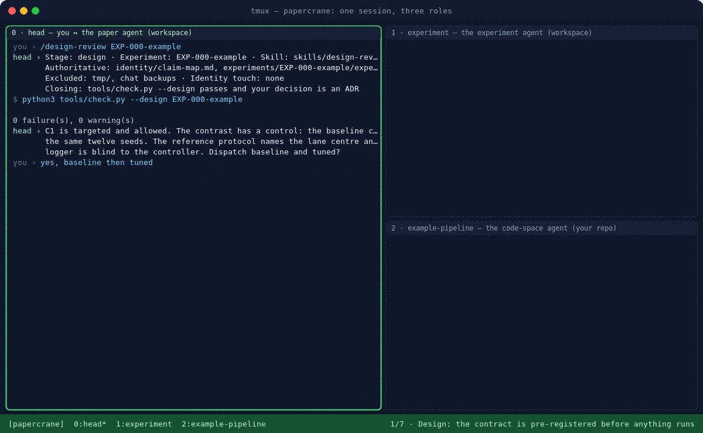

# A session, pane by pane

How a day with the workspace looks. Three roles, three terminals, one loop. The animation
in the README is produced by `make session`, which really runs every command below on the
toy pipeline; only the `you ›` and `head ›` lines are scripted.

## The three panes

| Pane | Who sits there | What happens there |
|------|----------------|--------------------|
| 0 · head | you and the paper agent, in the workspace | the session contract, design review, the Interpret conversation, the ADR, render and check |
| 1 · experiment | the experiment agent, in the workspace | polls its queue, dispatches runs, waits for the code space, freezes facts, builds the leaderboard, reports back |
| 2 · code space | the code-space agent, inside your repository | polls its queue, runs `make run`, acknowledges with the path of `facts.json` |

Open them for real with `tools/dev/tmux-session.sh` (defaults: `claude` in each pane, the toy
pipeline as the code space). Any runtime works in a pane; the bus is a directory of files.

## The seven beats

1. **Design.** You type `/design-review EXP-000-example`. Head opens with the eight-line
   contract, runs `tools/check.py --design`, and tells you what the contract has: a targeted
   claim that is allowed, a control for the contrast, a blind reference protocol. You say
   dispatch.
2. **Hand-off.** Head sends one bus message to `experiment` with the two runs to make. It
   does not run anything itself.
3. **Run r01.** The experiment agent dispatches; `dispatch.py` writes the run record and
   enqueues a task for the code space. In pane 2 the code-space agent polls, runs
   `make run`, and acks with the facts path. Back in pane 1, `bus.py wait` sees the ack and
   `freeze.py` copies the facts into `reality/` with their hash.
4. **Run r02.** The same, for the tuned controller, with `--baseline r01`.
5. **Analyze.** `compare.py` prints the leaderboard; the experiment agent acks head's task.
   Head reports to you in questions: does the paper carry r02 against r01, and is a drop of
   this size what you expected?
6. **Interpret.** You decide. Head drafts ADR-0001 (decision, alternatives rejected, why),
   you say ok, the file is written. This is the only place a claim-shaped decision enters the
   workspace, and a human made it.
7. **Write.** `render-facts.py` compiles the five numbers into `facts.tex`; `check.py` is green;
   `make pdf` builds the page whose Results sentence reads them. The stage closes on its
   closing condition: the ADR exists and the checker passes.

The full transcript, with every output, is in [assets/session/transcript.md](assets/session/transcript.md).

## Following the method with your own paper

- Keep pane 0 for thinking. The three human-led stages happen there: Idea, Design,
  Interpret. Everything you say that changes the paper becomes an ADR before the session ends.
- Let pane 1 turn fast. Dispatch, freeze, compare, report. If the experiment agent starts
  interpreting, it is out of role; ask for questions, not conclusions.
- Pane 2 is your code. The only thing the loop asks of it is `make run` and a `facts.json`
  with provenance.
- When a run lands on numbers the paper already uses, `impact.py` tells you which sentences,
  figures and claim rows depend on the old value before you touch any of them.
